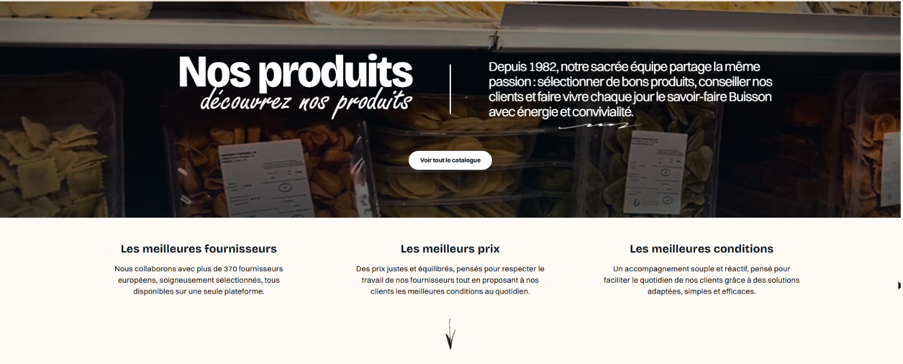
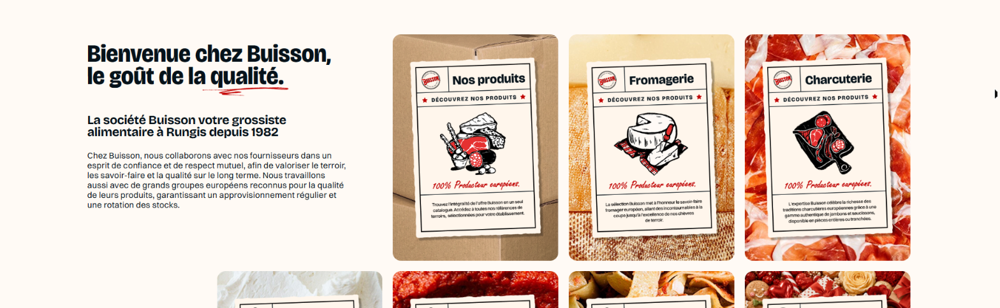
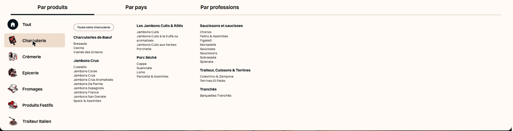
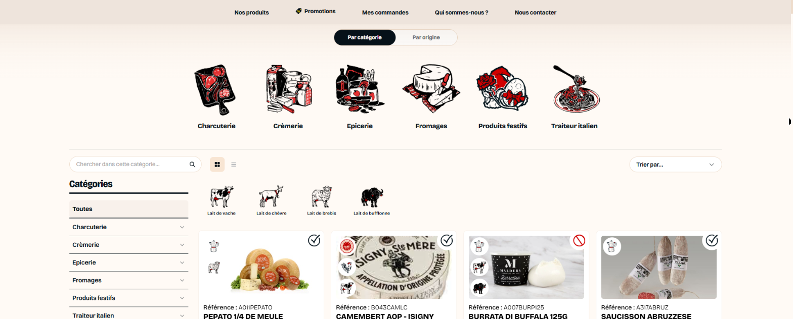

# Site e-commerce B2B/B2C Buisson

> Vitrine d'un projet professionnel réalisé chez **INPEC (Ingénieur Patrice Edeline Conseils)** pour **Buisson**, grossiste alimentaire à Rungis depuis 1982.
> Le code appartient à l'employeur et reste privé : ce dépôt présente le projet et des captures d'écran.

🔗 **Site en ligne : [web.buisson-sa.com](https://web.buisson-sa.com)**

## Le projet

Site de vente en ligne pour les professionnels (B2B) et les particuliers (B2C) : plus de 370 fournisseurs européens, un catalogue de charcuterie, fromages, crèmerie, épicerie et traiteur italien.

## Ce que j'ai réalisé

- **Catalogue** : méga-menu (par produits, par pays, par professions), tuiles de rayons, filtres (catégorie, origine du lait, produit fermier, ultra-frais, promotion, disponibilité), recherche, vue grille ou liste.
- **Fiches articles** et cartes produit : références, labels (AOP…), statut de disponibilité, favoris, ajout au panier.
- **Espace client** : commandes, favoris, choix du compte de facturation.
- **Promotions** : page dédiée et articles en promotion mis en avant.
- **Espace fournisseur** : produits, stock, factures et règlements consultables par les fournisseurs.
- **Synchronisation avec l'ERP** de l'entreprise (articles, clients, commandes).

## Technologies

Laravel 11 · PHP 8 · JavaScript (AJAX) · Tailwind CSS · MySQL

## Captures d'écran

**Page d'accueil**

**Présentation et rayons**

**Méga-menu des catégories**

**Catalogue avec filtres**

---

Axel (Mostapha) Ouahmane · [LinkedIn](https://www.linkedin.com/in/axel-ouahmane) · [GitHub](https://github.com/AxelOuahmne)
